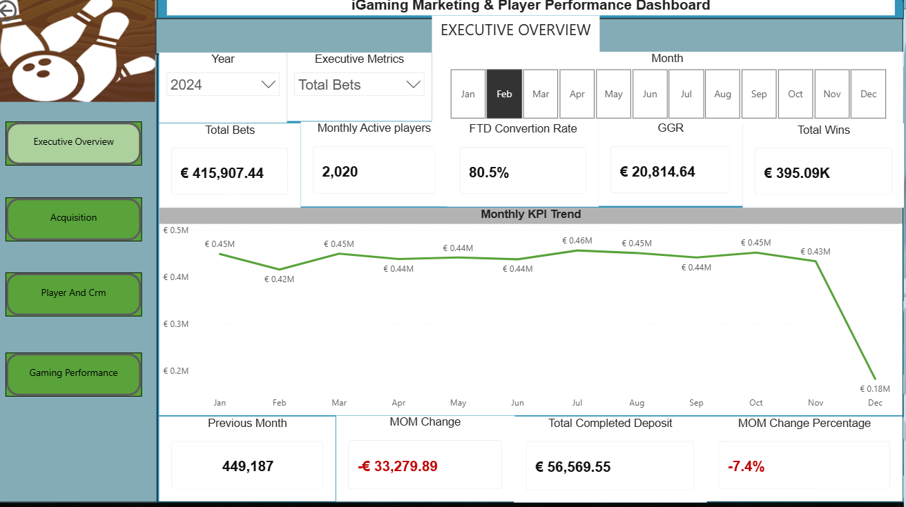
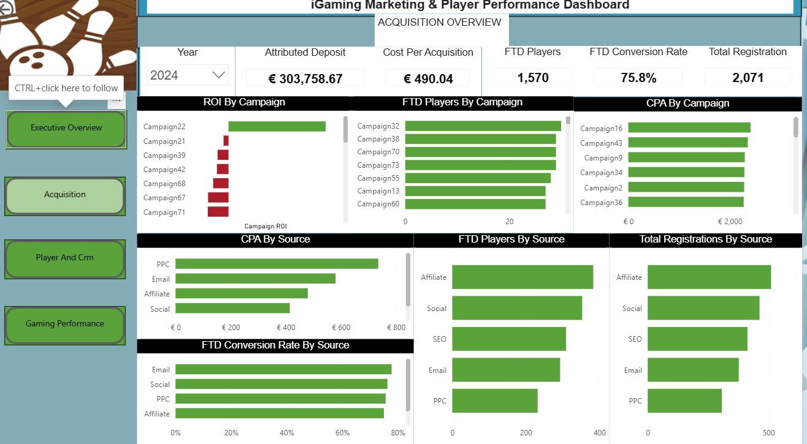
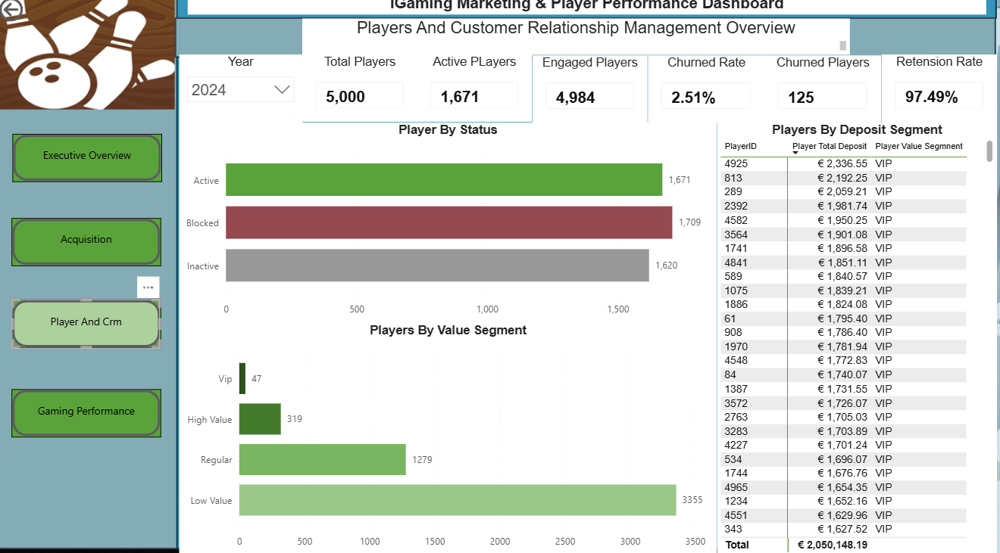
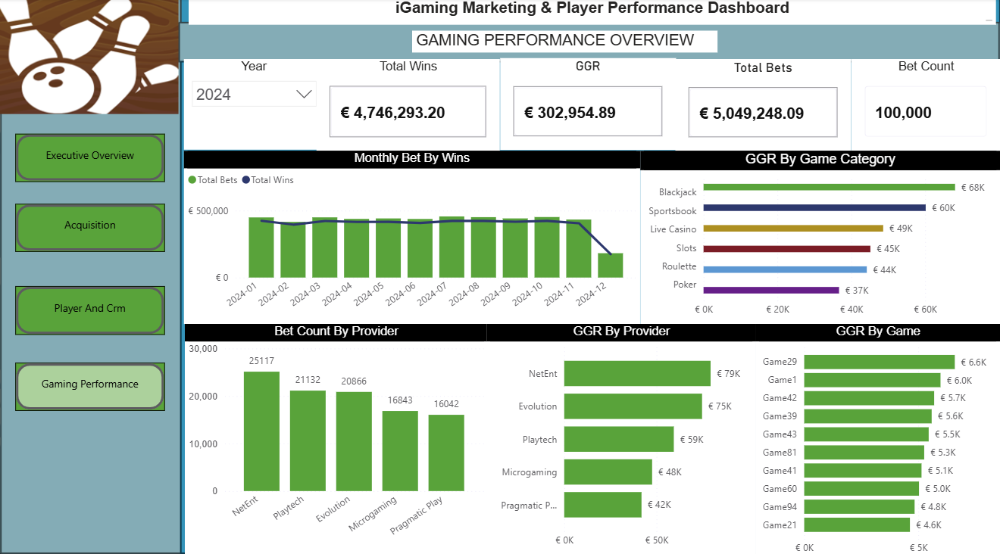
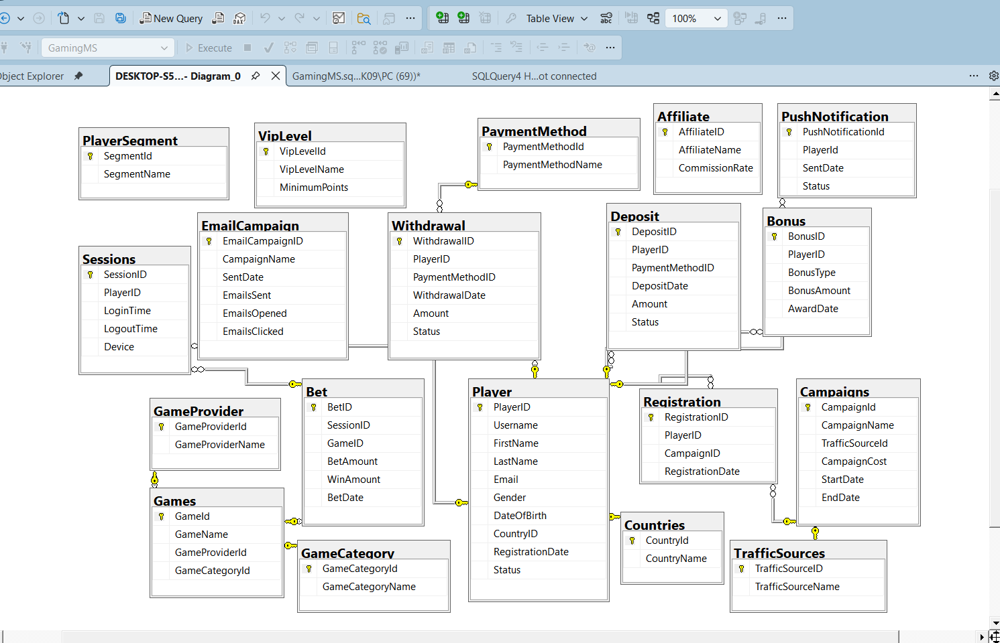
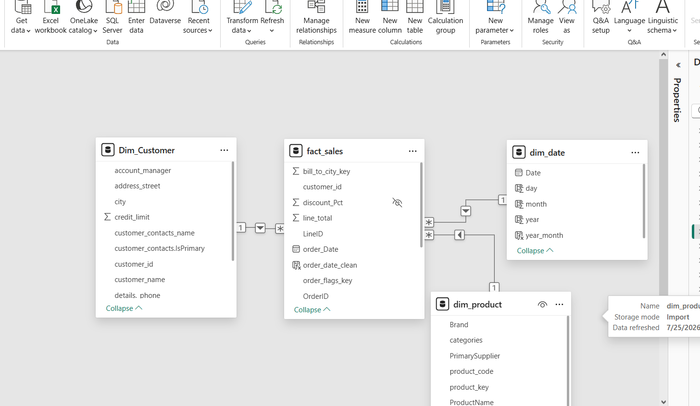

# iGaming Marketing & Player Performance Analytics

**SQL Server · T-SQL · Power Query · DAX · Power BI**

[Watch the dashboard walkthrough on LinkedIn](https://lnkd.in/p/dbAtZs49) · [Download the Power BI report](Gamingms.pbix) · [Explore curated SQL analysis](sql/README.md)

## Overview

An end-to-end analytics portfolio project exploring player acquisition, CRM performance, and gaming revenue using **synthetic iGaming data**. The four interactive Power BI pages are designed to answer commercial and operational questions, not just display charts.

## Dashboards

### 1. Executive Overview

Explore registrations, first-time deposits (FTDs), completed deposits, active players, gross gaming revenue (GGR), monthly trends and month-over-month comparisons. The metric selector and date filters support interactive exploration.

### 2. Marketing Acquisition

Compare campaign ROI, cost per acquisition (CPA), attributed deposits, first-time deposit players and conversion by campaign and traffic source.

### 3. Player & CRM Analytics

Analyse player status, activity, churn, retention and value-based segmentation to identify potential CRM priorities.

### 4. Gaming Performance

Explore bets, wins, GGR, game categories, providers and individual games.

## Selected Findings

The following figures are taken from the **2024 Gaming Performance** dashboard view:

| Metric | Dashboard value |
| --- | ---: |
| Number of bets | 100,000 |
| Total bet amount | €5,049,248.09 |
| Total wins | €4,746,293.20 |
| Gross gaming revenue (bets minus wins) | €302,954.89 |

In that view, **Blackjack** generated approximately **€68K GGR**, the largest amount among the displayed game categories. **NetEnt** led the displayed game providers with approximately **€79K GGR** and **25,117 bets**.

These are results from the synthetic project dataset, not actual operator financial results. Other figures change with the dashboard's filters.

## Data Model

**SQL Server database diagram**

**Power BI relationships**

The model brings together registrations, players, campaigns, deposits, sessions, betting activity, game metadata and related lookup tables. Relationships and filter context support the reporting measures.

## Tools and Methods

- **SQL Server / T-SQL:** Joins, aggregations, CTEs, window functions, campaign analysis and read-only data quality checks
- **Power Query:** Data preparation and transformation
- **Power BI:** Data modelling, interactive visuals, slicers and report navigation
- **DAX:** Business KPIs and time-based measures

## Files

| File | Purpose |
| --- | --- |
| [Gamingms.pbix](Gamingms.pbix) | Power BI report and model |
| [Organised SQL portfolio](sql/README.md) | Five curated read-only analysis and data-quality scripts |\n| [GamingMS_Development.sql](GamingMS_Development.sql) | Original SQL learning and development record (not intended for end-to-end execution) |
| [Executive Overview](01_Executive_Overview.png) | Dashboard screenshot |
| [Marketing Acquisition](02_Marketing_Acquisition.png) | Dashboard screenshot |
| [Player & CRM](03_Player_CRM.png) | Dashboard screenshot |
| [Gaming Performance](04_Gaming_Performance.png) | Dashboard screenshot |
| [SQL database diagram](SQL_Database_Diagram.png) | SQL Server entity relationships |
| [Power BI relationships](PowerBI_Relationships.png) | Power BI semantic model |

**SQL note:** The cleaned queries are organised in the [`sql/` folder](sql/README.md). They are read-only, with naming and metric limitations explained in the SQL guide. The original `GamingMS_Development.sql` remains available as a historical learning record and is **not** a clean-install script. The cleaned queries have been reviewed statically but have **not** been executed against the database in this session. Source CSV files are not included.

## Business Questions

- Which acquisition channels and campaigns deliver stronger conversion and return?
- What do player activity and value segments suggest about CRM priorities?
- Which games and providers contribute most to gaming revenue?
- How do performance metrics change over time?

## Project Scope

This project is a skills demonstration using **synthetic data**, not confidential company records. The report illustrates analytics workflows relevant to BI, marketing analysis, CRM and iGaming performance reporting.
